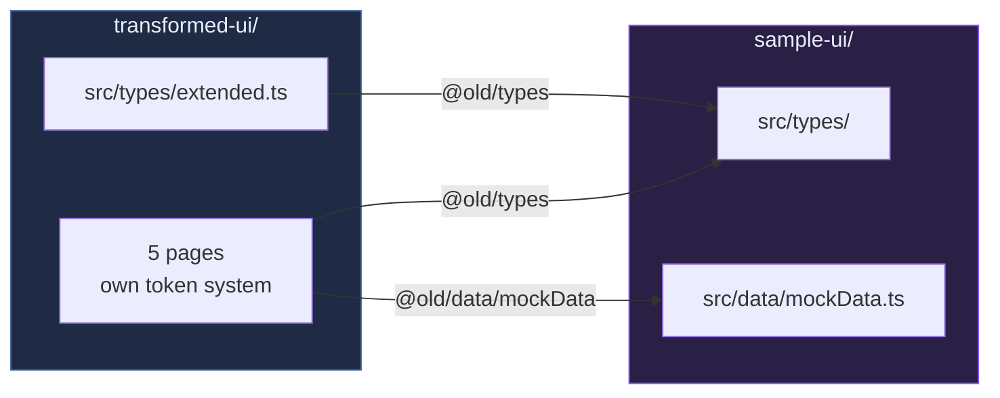

<div align="center">

# Clinical Trial Eligibility Pre-Screener

**One product, built twice — two interface architectures for the same oncology screening workflow.**

[](LICENSE)
[](#-requirements)
[](#-architecture)
[](#-architecture)
[](#-all-clinical-data-here-is-synthetic)
[](#-all-clinical-data-here-is-synthetic)

[🚀 Quick start](#-quick-start) · [🔗 The coupling](#-the-two-apps-are-coupled) · [🏗 Architecture](#-architecture) · [⚕️ Synthetic data](#-all-clinical-data-here-is-synthetic) · [📂 Layout](#-repository-layout)

</div>

---

Both apps in this repository screen oncology patients against clinical trial criteria and
ask a human to review every result. They differ in **how the interface is organised**, and
that difference is the point of the repo.

## 🧭 The two treatments

|  | [`sample-ui/`](sample-ui) | [`transformed-ui/`](transformed-ui) |
|---|---|---|
| **Shape** | Feature-dense coordinator workbench | Focused 5-page redesign |
| **Surfaces** | 14 routes, four workspaces | 5 pages |
| **Styling** | Design primitives + a `ctp-` class layer | Its own CSS custom-property token system |
| **Charts** | visx | Hand-built SVG |
| **Backend** | Local API on `:4180`, optional Postgres research worker | None — dev proxy only |
| **Also has** | SBAR clinical handoffs, research digests, audit replay | Mission control, deep review, insights, trial config, audit trace |

`sample-ui` came first and grew by accretion: every workflow that mattered got a surface,
and the result rewards an operator who already knows the domain. `transformed-ui` is the
redesign — same domain model, same mock data, five pages, built around one coordinator's
8:30 AM queue review rather than around the feature inventory.

Reading them side by side is more informative than reading either alone.

## 🚀 Quick start

> [!IMPORTANT]
> Clone the **whole repository**. `transformed-ui` imports from `sample-ui` at build time
> and will not compile on its own — see [The coupling](#-the-two-apps-are-coupled).

Each app is its own npm project. Install inside the one you want.

```bash
git clone https://github.com/vinayagrw/clinical-trial-prescreener-agentic.git
cd clinical-trial-prescreener-agentic
```

<table>
<tr><th><code>sample-ui</code> — the workbench</th><th><code>transformed-ui</code> — the redesign</th></tr>
<tr><td>

```bash
cd sample-ui
npm install
npm run dev
```

Client on **`127.0.0.1:4174`**, local API on
**`127.0.0.1:4180`** — one command starts both.

Entry points:
`/cockpit` · `/handoffs` · `/research-digests`

</td><td>

```bash
cd transformed-ui
npm install
npm run dev
```

**`localhost:4175`**.

`/` redirects to `/mission-control`.

</td></tr>
</table>

Both apps run with **no API keys and no external services**, on fixture data.

<details>
<summary><b>Two optional paths, and how each degrades</b></summary>

Neither is required to see the apps work. Both fail honestly rather than silently.

| Optional path | How to enable | Without it |
|---|---|---|
| `transformed-ui` Ask Agent → live Anthropic API | `ANTHROPIC_API_KEY` in the environment | Falls back to canned keyword-matched responses. The demo is complete either way. |
| `sample-ui` research-digest workspace | `RESEARCH_DATABASE_URL` → Postgres with pgvector | Does **not** fall back to mock publication data. Use `/cockpit` and `/handoffs` instead. |

The Anthropic key is injected server-side by the Vite dev proxy in its `configure()` hook
and never reaches the browser bundle.

`sample-ui` ships a `.env.example` — copy it to `.env` and fill in what you need.
`transformed-ui` reads `ANTHROPIC_API_KEY` from the environment directly. **No real
credentials are committed anywhere in this repository.**

</details>

## 📋 Requirements

**Node.js 22 or newer.** `sample-ui`'s local API runs under
`node --experimental-strip-types`, which requires 22. npm ships with Node; there is nothing
else to install globally.

## 🔗 The two apps are coupled

`transformed-ui` reuses `sample-ui`'s domain types and mock data through a build-time
Vite/TypeScript alias. **17 imports across 16 files** depend on it — 16 × `@old/types`,
1 × `@old/data/mockData`.



The alias is declared **twice**, and both must agree:

| File | Declaration |
|---|---|
| [`transformed-ui/vite.config.ts`](transformed-ui/vite.config.ts) | `resolve.alias` → `"@old": path.resolve(__dirname, "../sample-ui/src")` |
| [`transformed-ui/tsconfig.json`](transformed-ui/tsconfig.json) | `compilerOptions.paths` → `"@old/*": ["../sample-ui/src/*"]` |

> [!WARNING]
> If `sample-ui/` is missing or renamed, `transformed-ui`'s typecheck **and** its build both
> fail. Its `build` script is `tsc --noEmit && vite build`, so a broken alias stops the
> build rather than producing a subtly wrong bundle.

## 🏗 Architecture

Shared across both: **React 18.3 · TypeScript 5.6 · Vite 5.4 · react-router-dom 6**, route
code-splitting, and no runtime dependency on a server for the core workflow.

```
clinical-trial-prescreener-agentic/
├── sample-ui/              # the feature-dense workbench
│   ├── src/                # 14 routes, four workspaces, visx charts
│   ├── server/             # local API (:4180) + research worker
│   └── .env.example
├── transformed-ui/         # the 5-page redesign
│   ├── src/                # own CSS token system, hand-built SVG charts
│   └── vite.config.ts      # @old alias → ../sample-ui/src
├── LICENSE                 # MIT
└── README.md
```

## ⚕️ All clinical data here is synthetic

> [!CAUTION]
> Every patient, chart, note, protocol, trial, biomarker, outcome and audit record in both
> apps is **fabricated for demonstration**. There is no PHI, no de-identified real patient
> data, and no connection to any health system. Patient names, MRNs, clinician personas,
> site names and trial identifiers are invented; any resemblance to a real record is
> coincidence. The apps state this in their own UI.

Both apps are **prototypes**. They demonstrate interface and workflow design, not a
deployable clinical system:

- Eligibility logic is static mock assessment data, not a rule engine.
- Nothing persists beyond a `localStorage` theme preference.
- There is no authentication, authorisation, or EHR integration.

Each app's README has a candid *"what's real vs what's mock"* section. **Read it before
drawing conclusions about what works.**

## 📂 Repository layout

Per-app detail — routes, feature tours, user stories by persona, the domain model, the
real-vs-mock tables, and a roadmap from prototype to pilot:

- 📘 [`sample-ui/README.md`](sample-ui/README.md) — the workbench
- 📗 [`transformed-ui/README.md`](transformed-ui/README.md) — the redesign

## 📄 License

MIT — see [LICENSE](LICENSE).
